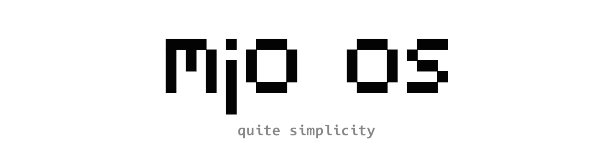
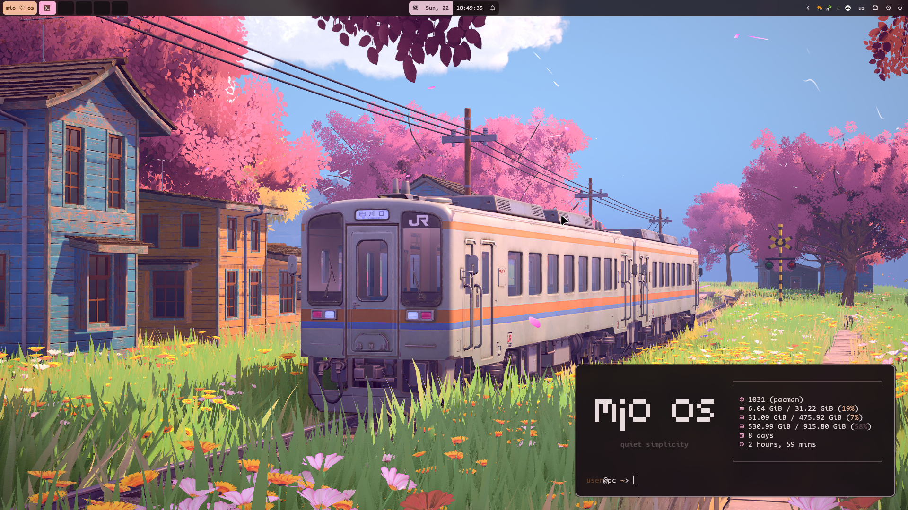
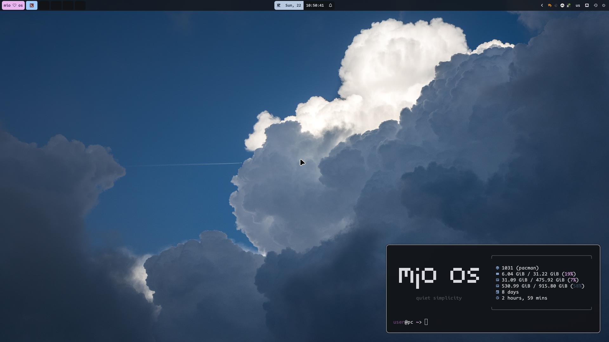
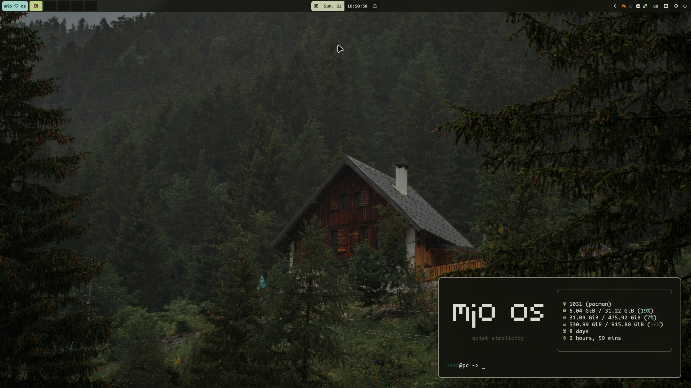
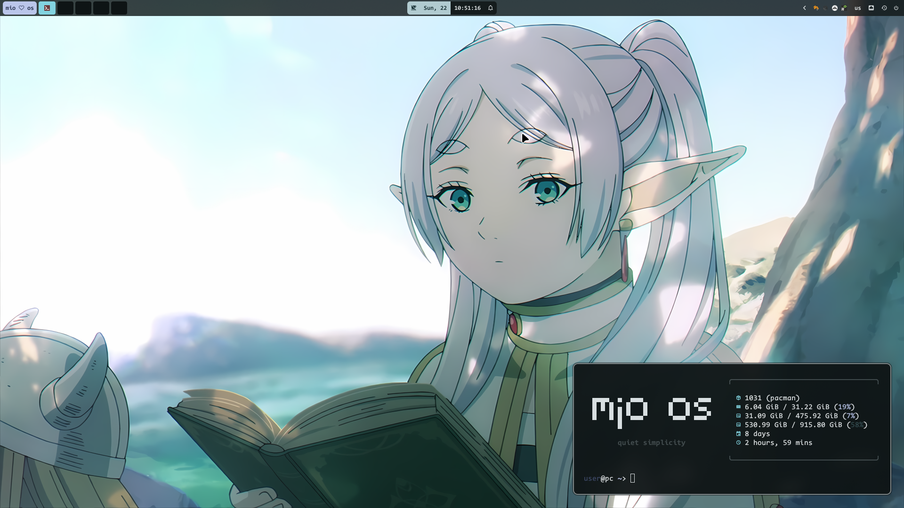
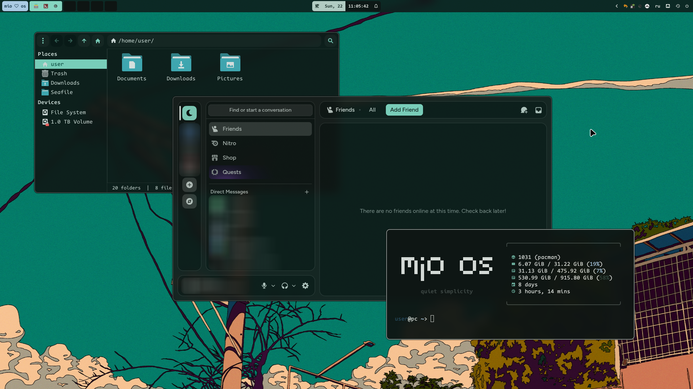
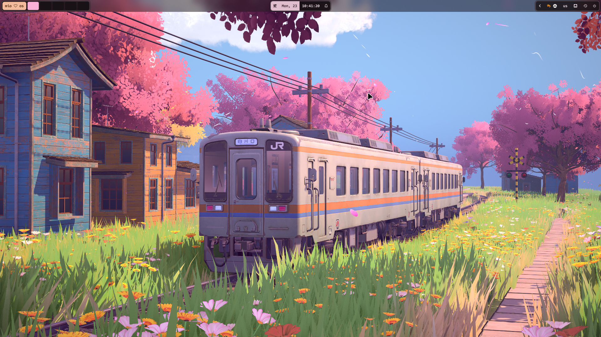
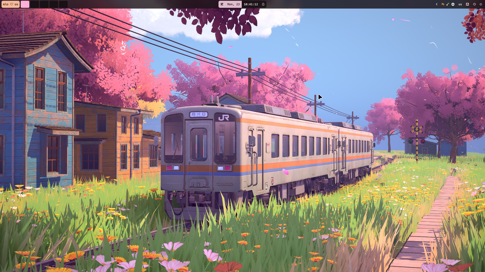
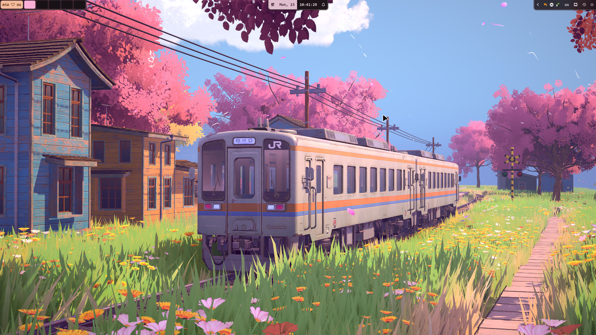

    
## about

- operatingSystem: `arch` / `arch-based distribution`
- windowManager: `hyprland` (+ `hyprlock`, `hypridle`)
- statusBar: `waybar`
- terminal: `kitty`
- shell: `fish`
- appLauncher: `rofi` (emoji, calc)
- notifyDaemon: `dunst`
- wallpaperDaemon: `awww`
- colorGeneratorTool: `matugen`
- fileManager: `thunar`
- screenshots: `grim` + `slurp` + `satty`
- clipboard: `wl-clipboard` + `cliphist`
- theme: `adw-gtk-theme`, `papirus`, `bibata` cursor
- font: `CodeNewRoman Nerd Font`

> ~55 packages in total (dependencies not included), see [pkgList](packages/pkgList) and [aurPkgList](packages/aurPkgList)

## gallery

<table>
  <tr>
    <td></td>
    <td></td>
  </tr>
  <tr>
    <td></td>
    <td></td>
  </tr>
  <tr>
    <td colspan="2"></td>
  </tr>
</table>

### waybarStyles

<table>
  <tr>
    <td width="33%"></td>
    <td width="33%"></td>
    <td width="33%"></td>
  </tr>
  <tr>
    <td align="center">default</td>
    <td align="center">flat</td>
    <td align="center">floating</td>
  </tr>
</table>

## docs

- [install](docs/install.md)
- [keybinds](docs/keybinds.md)

## license

MIT, see [LICENSE](LICENSE). 
Wallpapers belong to their respective authors.
